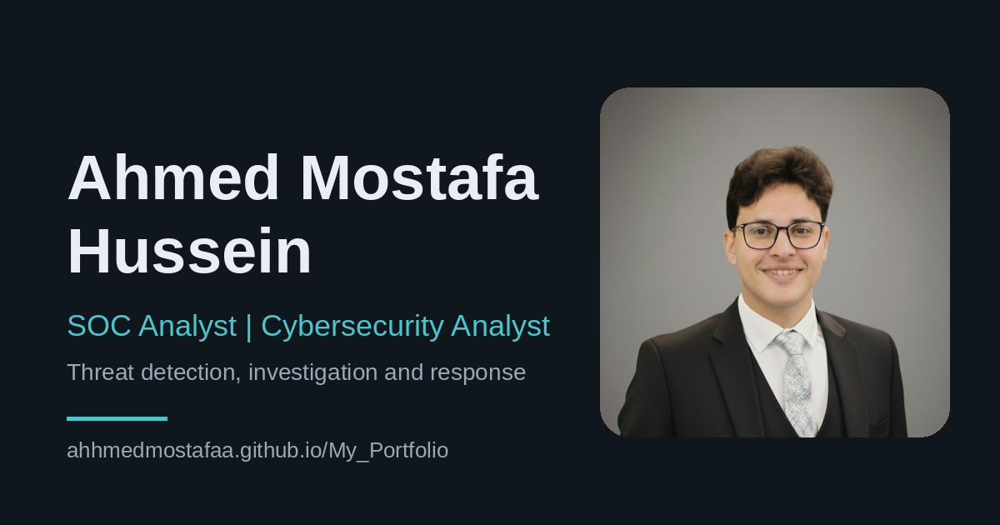

# Ahmed Mostafa Hussein: Portfolio

**Live site:** https://ahhmedmostafaa.github.io/My_Portfolio/



Personal portfolio of Ahmed Mostafa Hussein, an entry-level SOC Analyst based in Cairo, Egypt. It presents two hands-on security labs, certifications and supporting projects, with a focus on threat detection, alert investigation and incident response.

## What is on the site

- **Project 01: SOC Home Lab.** A self-built enterprise network with Active Directory, a Splunk SIEM, 10 custom detections mapped to MITRE ATT&CK, manual threat hunting, hybrid Azure monitoring and SOAR automation with human approval. [Repository](https://github.com/ahhmedmostafaa/SOC-SIEM-SOAR-HomeLab)
- **Project 02: AI-Powered Cybersecurity Lab.** A multi-layer defense that combines an XGBoost classifier, Suricata, Zeek and automatic pfSense blocking. [Repository](https://github.com/ahhmedmostafaa/AI_Powered_Cybersecurity_Lab)
- **How I work and how I got here:** the analyst workflow I follow, and a short timeline of my training.
- **Toolbox:** tools grouped by what I use them for.
- **Credentials:** 15 certifications, each with a link to check it.
- **More work:** selected networking, machine learning and embedded projects.

## Built with

Plain HTML, CSS and JavaScript in a single `index.html`. There is no framework, no build step and no tracking.

- Responsive layout for phones, tablets and laptops
- Light and dark themes: the site follows the device setting, and a manual switch is remembered
- Motion respects the "reduce motion" setting
- Semantic headings, skip link, keyboard navigation, visible focus states and descriptive image text
- Colour tokens checked against WCAG AA contrast in both themes
- Images served as compressed WebP, with a vector SVG for the zoomable architecture diagram

## Repository structure

```text
index.html                       The whole site: markup, styles and scripts
404.html                         Custom "page not found" page
Ahmed_Hussein_CV.pdf             Downloadable CV
profile.jpg                      Portrait
og-image.png                     Social share preview (1200 x 630)
favicon.svg, favicon.png         Site icon
apple-touch-icon.png             iPhone home-screen icon
network-topology.webp            AI lab network diagram (full size)
network-topology-1200.webp       AI lab network diagram (phone size)
soc-homelab-cover.svg            SOC home lab architecture (vector, for zoom)
soc-homelab-cover.webp           SOC home lab architecture (full size)
soc-homelab-cover-1200.webp      SOC home lab architecture (phone size)
```

## Run locally

Open `index.html` in a browser, or serve the folder:

```bash
python -m http.server 8000
```

Then open http://localhost:8000.

## Deployment

Hosted with GitHub Pages from the root of the `main` branch. A commit goes live in a minute or two.

## Credits

- Fonts: Schibsted Grotesk and JetBrains Mono through Google Fonts. A small subset of Inter is embedded in the SOC lab diagram. All three are licensed under the SIL Open Font License.
- Line icons are adapted from [Feather](https://feathericons.com) (MIT License).

## Copyright

Copyright 2026 Ahmed Mostafa Hussein. The text, photo, CV and diagrams are my own work and are not licensed for reuse. You are welcome to take inspiration from the layout, but please do not copy the content.

## Contact

- LinkedIn: [ahmedmostafahussein](https://www.linkedin.com/in/ahmedmostafahussein)
- GitHub: [ahhmedmostafaa](https://github.com/ahhmedmostafaa)
- Email: [a7medmostafa7777@gmail.com](mailto:a7medmostafa7777@gmail.com)
